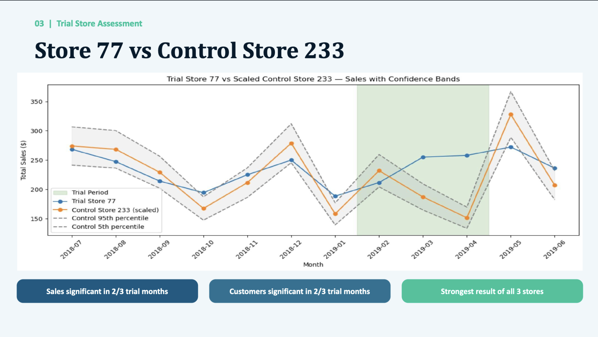
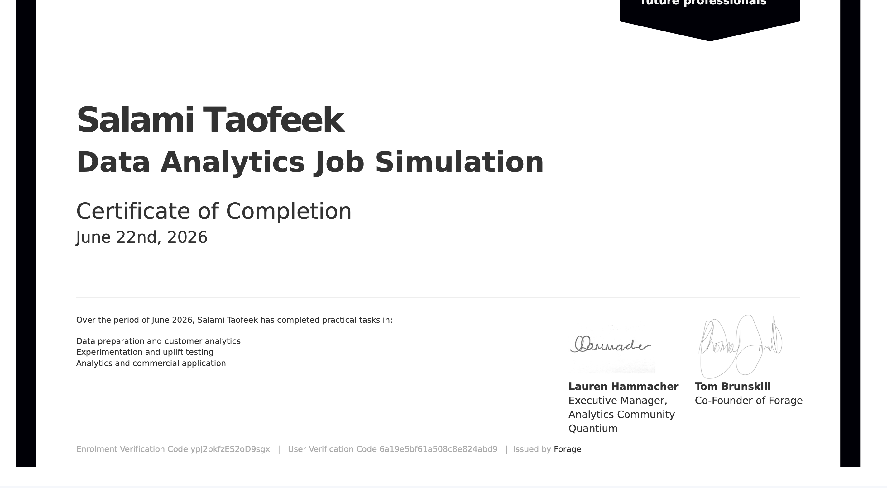

# Quantium Data Analytics Virtual Experience
### Forage Job Simulation | June 2026

This repository contains my completed work for the **Quantium Data Analytics Job Simulation** on Forage — a practical, real-world analytics engagement centred on chip category purchasing behaviour and retail trial store performance.



---

## Certificate of Completion

[](https://www.theforage.com/completion-certificates/32A6DqtsbF7LbKdcq/NkaC7knWtjSbi6aYv_32A6DqtsbF7LbKdcq_6a19e5bf61a508c8e824abd9_1782130518123_completion_certificate.pdf)

**Credential ID:** ypJ2bkfzES2oD9sgx  
**Issued by:** Forage | June 22, 2026  
**Verify:** [View Certificate](https://www.theforage.com/completion-certificates/32A6DqtsbF7LbKdcq/NkaC7knWtjSbi6aYv_32A6DqtsbF7LbKdcq_6a19e5bf61a508c8e824abd9_1782130518123_completion_certificate.pdf)

---

## Project Overview

As part of Quantium's retail analytics team, I was tasked with analysing chip purchasing behaviour and evaluating trial store performance to provide strategic recommendations to a Category Manager (Julia) for the upcoming half-year strategic plan.

**Data scope:** 264,836 raw transactions across 272 stores, July 2018 – June 2019, covering 72,637 loyalty customers. After cleaning, 246,740 chip transactions across 271 stores remain.

> **Status:** Complete (June 2026). Re-run in October 2026 after a cleaning error was fixed; see Corrections. The figures below are from the corrected run. The report submitted to Forage (`Quantium_Category_Strategy_Report.pdf`) is kept as submitted.

---

## Tasks Completed

### Task 1 — Data Preparation & Customer Analytics
**Notebook:** `notebooks/task1_data_prep.ipynb`

- Loaded and cleaned two datasets: transaction data (264,836 rows) and customer purchase behaviour (72,637 rows)
- Fixed Excel serial date format, cleaned product name spacing, removed a bulk buyer outlier (200-unit purchases), and removed 18,094 rows of salsa products (nine products; store 211 sold only salsa, so it drops out)
- Engineered two new features: `PACK_SIZE` and `BRAND`, extracted from product names using regex
- Standardised brand names into 20 brands (e.g. `RRD` → `Red Rock Deli`, `GrnWves` → `Grain Waves`)
- Merged transaction and customer data on loyalty card number with zero data loss (246,740 rows, 12 columns)
- Defined a 10-KPI framework and analysed sales and customer counts by lifestage and spending tier

**Key findings:**
- Total chip sales: $1.81M across 71,287 unique customers
- Families (Older and Young) are the highest-value customers per head, spending $32–$35 on average with 4.4–4.7 transactions per customer
- Young Singles/Couples Mainstream generate the second-highest total sales ($148K, after Budget Older Families at $157K) through volume — 7,917 customers spending just $18.64 each on average
- Kettle is the top brand by sales, and 175g the top pack size, in each segment examined (Older Families, Young Families, Mainstream Young Singles/Couples)

---

### Task 2 — Experimentation & Uplift Testing
**Notebook:** `notebooks/task2_trial_vs_control.ipynb`

- Aggregated transaction data to store-month level (3,165 records across 271 stores)
- Built a composite similarity scoring function using Pearson correlation and normalised magnitude distance across two metrics (total sales and number of customers) to identify control stores for trial stores 77, 86, and 88
- Selected control stores: 233 (score: 0.98), 155 (score: 0.92), and 237 (score: 0.77)
- Visualised pre-trial trends for all three pairs to validate matches
- Applied pre-trial scaling factors to control store data to account for baseline size differences
- Plotted 5th and 95th percentile confidence bands derived from pre-trial standard deviation to assess statistical significance of trial period uplift

**Results:**

| Trial Store | Control Store | Sales Uplift | Customer Uplift | Significant Months |
|-------------|--------------|-------------|----------------|-------------------|
| 77 | 233 | +32.9% | +27.9% | 2/3 sales, 2/3 customers |
| 86 | 155 | +8.4% | +13.0% | 2/3 sales, 3/3 customers |
| 88 | 237 | +13.2% | +6.6% | 2/3 sales, 1/3 customers |

Significant months are trial months in which the trial store is above the control store's 95th percentile band; the notebook prints them for each store.

**Conclusion:** All three trial stores outperformed their control stores during the trial period. Store 77 has the largest uplift (+32.9% sales) and the closest control match (0.98). Store 86 has the most months above the band for customers (3 of 3), with a smaller sales uplift (+8.4%). Store 88's results should be read with caution because of its weaker pre-trial control match (0.77). With three trial months each, these results support the trial layout; they do not prove it.

---

### Task 3 — Analytics & Commercial Application
Prepared a client-facing PowerPoint presentation for Julia (Category Manager) 
structured using the Pyramid Principles framework, incorporating data 
visualisations, key callouts, insights, and strategic recommendations across 
13 slides.

**Deliverable:** [`Quantium_Category_Strategy_Report.pdf`](./Quantium_Category_Strategy_Report.pdf) — client-facing presentation submitted to Quantium's Category Manager.

---

## Repository Structure

```
forage-quantium-data-analytics/
├── data/
│   ├── QVI_data_clean.csv          ← cleaned & merged dataset (Task 1 output)
│   └── Trial_score.png             ← trial results image used at the top of this README
├── notebooks/
│   ├── task1_data_prep.ipynb       ← data cleaning, EDA, customer segment analysis
│   └── task2_trial_vs_control.ipynb ← control store selection, uplift testing
├── outputs/
│   ├── sales_by_segment.png
│   ├── avg_spend_by_segment.png
│   ├── control_store_match_sales.png
│   ├── control_store_match_customers.png
│   ├── trial_assessment_sales.png
│   ├── store77_sales_confidence.png
│   ├── store77_customers_confidence.png
│   ├── store86_sales_confidence.png
│   ├── store86_customers_confidence.png
│   ├── store88_sales_confidence.png
│   └── store88_customers_confidence.png
├── Forage_Certificate.png
├── Quantium_Category_Strategy_Report.pdf
├── .gitignore
└── README.md
```

---

## Tools & Libraries

| Tool | Purpose |
|------|---------|
| Python 3 | Core language |
| pandas | Data loading, cleaning, aggregation |
| matplotlib | Data visualisation |
| scipy | Pearson correlation for control store matching |
| Jupyter Notebook | Development environment |

---

## Data Source

Transaction and customer data sourced from the **Quantium Data Analytics Virtual Experience Program** on [Forage](https://www.theforage.com). 
Raw data files are excluded from this repository per Forage's terms; the cleaned output (`QVI_data_clean.csv`) is included. To re-run the notebooks, download `QVI_transaction_data.xlsx` and `QVI_purchase_behaviour.csv` from the Forage programme into `data/`, then run `task1_data_prep.ipynb` and `task2_trial_vs_control.ipynb` in order from a restarted kernel.


---

## Corrections

**29 October 2026**

- **Cleaning filter:** the non-chip filter matched "Salsa" or "Dip", so it also removed a chip product, Smiths Crinkle Cut French OnionDip 150g (1,438 transactions). The filter now matches "Salsa" only, as the brief specifies. Both notebooks were re-run, and every figure above comes from that run: 246,740 rows (previously 245,302), $1.81M sales (previously $1.80M), 71,287 customers (previously 71,185), and trial uplifts of +32.9% / +27.9% for Store 77 (previously +33.5% / +29.1%), +8.4% / +13.0% for Store 86 (previously +8.5% / +12.7%) and +13.2% / +6.6% for Store 88 (unchanged).
- **Significant months:** the counts for Stores 86 and 88 had been read from the charts and were wrong even on the original data. The notebook now prints them: Store 86 has 2 of 3 months above the band for sales and 3 of 3 for customers (previously 1 and 2); Store 88 has 2 of 3 for sales (previously 1).
- **Store count:** the raw data covers 272 stores and the cleaned data 271. Store 211 sold only salsa products, so the filter removes it. "264,836 raw transactions across 271 stores" paired a raw count with a cleaned one.
- **Raw data files:** `QVI_transaction_data.xlsx` and `QVI_purchase_behaviour.csv` had been committed, despite the note below. They are no longer tracked and are listed in `.gitignore`; earlier commits still contain them.
- **Submitted report:** `Quantium_Category_Strategy_Report.pdf` is the report as submitted to Forage in June 2026 and still shows the earlier figures.

**26 October 2026**

- Top segment, store count and overstated claims corrected after the portfolio audit (pull request #1).

## Published Surfaces

Every place this project's findings appear outside this repository. When a figure changes, each one is updated and its date refreshed (Data Analysis Playbook v3.4, Published Surfaces).

| Surface | Link | Figures quoted | Last checked |
|---------|------|----------------|--------------|
| Project page | [taofeeksalami.com/forage-quantium-data-analytics](https://taofeeksalami.com/forage-quantium-data-analytics) | Full findings | 29 Oct 2026 |
| Portfolio site card | [taofeeksalami.com](https://taofeeksalami.com) | $1.81M sales, 71,287 customers, +32.9% peak uplift, 264,836 transactions, 72,637 customers | 29 Oct 2026 |
| GitHub profile README | [github.com/HarjiiBoss](https://github.com/HarjiiBoss) | 264,836 → 246,740 transactions, Budget Older Families $157K, +32.9% | 29 Oct 2026 |
| Resume | — | 264,836 → 246,740 chip purchases, 72,637 customers, +32.9% | 29 Oct 2026 |

---

*Taofeek Salami | [GitHub: HarjiiBoss](https://github.com/HarjiiBoss)*
